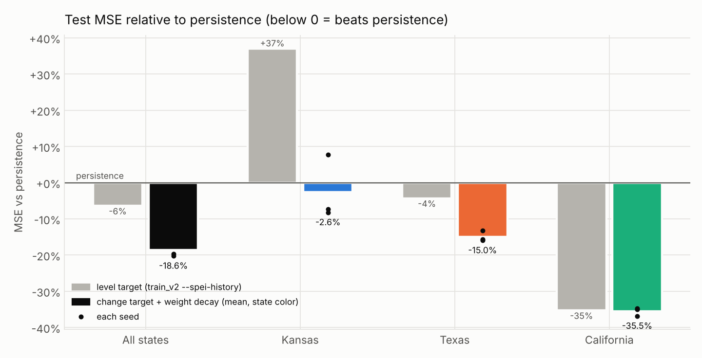

# Results — shared split v2 (Kansas, Texas, California)

Protocol, masks and normalization: [`SPLIT_v2.md`](SPLIT_v2.md). Every number below comes
from `python train_v2.py` on the data built by `python data_v2.py`; raw tables are in
[`metrics_v2/`](metrics_v2/) and the trained weights are
[`scratch_bilstm_v2.pt`](scratch_bilstm_v2.pt) (state_dict, 40,577 parameters, 171 KB).

## Setup in one line

Scratch `BiLSTM` (unchanged; `input_size=14`), hidden 64, Adam 1e-3, MSE, batch 256,
state-balanced sampling, seed 42, 30 epochs max, checkpoint with best `val_loss`.

| | train | val | test | cells |
|---|---|---|---|---|
| Kansas | 33,792 | 4,224 | 4,224 | 88 |
| Texas | 80,256 | 10,032 | 10,032 | 209 |
| California | 23,808 | 2,976 | 2,976 | 62 |
| **Total** | **137,856** | **17,232** | **17,232** | **359** |

**Best epoch: 1 of 30** (val MSE 0.265). Val loss rises from epoch 2 on while train loss
keeps falling (0.218 → 0.024 by epoch 30), so the kept checkpoint is the first epoch
(≈ 539 optimizer steps). The spatial-holdout model also peaks at epoch 1 (val 0.256).

## Test (2021-01 → 2024-12, all kept cells)

| Group | Model | n | MSE | MAE | Pearson r |
|---|---|---|---|---|---|
| All states | **BiLSTM** | 17,232 | **0.248** | **0.396** | **0.812** |
| | train mean | | 1.161 | 0.886 | — |
| | persistence | | 0.083 | 0.209 | 0.939 |
| Kansas | **BiLSTM** | 4,224 | **0.219** | **0.373** | **0.717** |
| | train mean | | 0.965 | 0.822 | — |
| | persistence | | 0.050 | 0.174 | 0.926 |
| Texas | **BiLSTM** | 10,032 | **0.265** | **0.411** | **0.773** |
| | train mean | | 1.103 | 0.853 | — |
| | persistence | | 0.083 | 0.214 | 0.930 |
| California | **BiLSTM** | 2,976 | **0.232** | **0.379** | **0.914** |
| | train mean | | 1.633 | 1.091 | — |
| | persistence | | 0.128 | 0.241 | 0.954 |

Train mean = 0.155 (one constant, so r is undefined). Persistence = SPEI-12 at t.

## Spatial check (unseen 2°×2° blocks, test years)

8 of 41 blocks (seed 42) holding 78 cells were removed from train and val; a second model
was trained without them and scored on those cells in 2021–2024. "Main model" is the
model above, which did train on these cells (earlier years), on the same samples.

| Group | n | BiLSTM, blocks unseen | Main model (blocks seen) | train mean | persistence |
|---|---|---|---|---|---|
| All | 3,744 | 0.232 (r 0.852) | 0.231 (r 0.855) | 1.196 | 0.085 (r 0.949) |
| Kansas | 480 | 0.142 (r 0.704) | 0.149 (r 0.689) | 0.620 | 0.058 (r 0.894) |
| Texas | 1,872 | 0.268 (r 0.793) | 0.271 (r 0.792) | 1.069 | 0.067 (r 0.948) |
| California | 1,392 | 0.215 (r 0.911) | 0.204 (r 0.918) | 1.566 | 0.120 (r 0.954) |

MSE unless noted; MAE is in `metrics_v2/spatial_holdout_metrics.csv`.

## Equivalence check (trained weights vs `nn.LSTM`)

`check_equivalence.run` on the best checkpoint: **PASS** in float32 (max |diff|
2.4e-7, atol 1e-6) and float64 (max |diff| 2.2e-16, atol 1e-12), for seq 1, 12 and 200,
with one bias and with the bias split across `bias_ih`/`bias_hh`.

## Figures

- [Loss curves, best epoch marked](figures_v2/loss_curves.png)
- [Predicted vs actual, per state](figures_v2/pred_vs_actual.png)
- [Per-state MSE and r vs both baselines](figures_v2/metrics_by_state.png)
- [Same, spatial holdout](figures_v2/spatial_holdout_metrics.png)
- [Map of kept SPEI cells by state, masked cells and holdout blocks](figures_v2/cells_map.png)
- [Equivalence check](figures_v2/equivalence.png)

## Honest read

- **Beats the train-mean baseline everywhere** — overall MSE 0.248 vs 1.161 (−79%), and
  in every state. The FLDAS anomalies carry real drought signal: r 0.81 overall, 0.91 in
  California.
- **Loses clearly to persistence everywhere** — 0.248 vs 0.083 overall (3.0× the
  error); 4.4× in Kansas, 3.2× in Texas, 1.8× in California. On this task (next-month
  SPEI-12, 11 of 12 months shared with SPEI-12 at t) a model that does not see past SPEI
  is not competitive with copying the last value. This is the headline result for the
  FLDAS-only inputs; adding SPEI history fixes most of it (see the variant below).
- **No sign of memorizing places.** On unseen 2°×2° blocks the held-out model matches the
  model that trained on those cells (0.232 vs 0.231), so what it learned transfers across
  space within these three states.
- **It overfits after one epoch.** Train MSE goes 0.218 → 0.024 while val MSE goes
  0.265 → 0.375. With ~138k strongly autocorrelated samples from 359 cells, the
  effective sample size is small for a 40.6k-parameter model with no regularization.
- **Run history.** A first full run had a normalization bug (per-cell std ≈ 0 gave
  |z| up to ~40,000 and constant predictions for two Kansas cells in test); its test MSE
  was 0.279. The std floor and ±10 clip fixed it (see SPLIT_v2.md); only the fixed run's
  numbers are reported above.

## Variant: + SPEI-12 history as input (`train_v2.py --spei-history`)

Same split, cells, masks, seed and hyperparameters; one extra input channel, SPEI-12 at
t-11..t (unscaled), so `input_size=15`. SPEI-12 at t uses climate up to t only, so the
t+1 target does not leak; its last month is exactly the persistence forecast. Outputs:
[`metrics_v2_spei/`](metrics_v2_spei/), [`figures_v2_spei/`](figures_v2_spei/),
[`scratch_bilstm_v2_spei.pt`](scratch_bilstm_v2_spei.pt) (173 KB).

**Best epoch: 2 of 30** (val MSE 0.078); val rises after, train keeps falling
(0.121 → 0.007). Equivalence check: **PASS** (float32 max |diff| 1.5e-7, float64 4.4e-16).

Test (2021–2024), MSE (Pearson r):

| Group | n | BiLSTM + SPEI history | vs persistence | persistence | FLDAS-only v2 | train mean |
|---|---|---|---|---|---|---|
| All states | 17,232 | **0.0774** (0.942) | −6.5% | 0.0828 (0.939) | 0.248 | 1.161 |
| Kansas | 4,224 | 0.0687 (0.908) | **+37%** | 0.0501 (0.926) | 0.219 | 0.965 |
| Texas | 10,032 | 0.0796 (0.933) | −4.3% | 0.0832 (0.930) | 0.265 | 1.103 |
| California | 2,976 | **0.0825** (0.969) | −35% | 0.1275 (0.954) | 0.232 | 1.633 |

Spatial check (same 8 blocks / 78 cells, test years), MSE:

| Group | Blocks unseen | Main model (blocks seen) | persistence |
|---|---|---|---|
| All | 0.0924 (+8.2% vs persistence) | 0.0780 (−8.7%) | 0.0854 |
| Kansas | 0.0581 (tie) | 0.0545 | 0.0581 |
| Texas | 0.1044 (+57%) | 0.0846 | 0.0666 |
| California | 0.0881 (−27%) | 0.0772 | 0.1201 |

Read:

- **SPEI history is the input that mattered.** Test MSE drops 69% (0.248 → 0.077) and the
  model now edges past persistence overall (−6.5%). That is the first teacher on this
  split that beats every baseline in aggregate.
- **The margin is small and uneven.** The overall win comes from California (−35%) and a
  little from Texas (−4%); in Kansas the model is 37% *worse* than persistence. One seed,
  autocorrelated samples: treat the overall −6.5% as promising, not settled.
- **It no longer transfers cleanly to unseen places.** On held-out blocks it loses to
  persistence (+8%), while the model that saw those cells beats it (−9%). Unlike the
  FLDAS-only run, part of the gain is location-specific.
- **Overfitting is still immediate** (best epoch 2), so regularization is the next lever.

## Variant: change target, regularized, 3 seeds (`train_v2_delta.py`)

Same inputs as the SPEI-history variant (15 channels), same split, cells, hidden 64,
Adam-family lr 1e-3, batch 256. Changes:

- **Target ΔSPEI-12 = SPEI-12(t+1) − SPEI-12(t)**; forecast = SPEI-12(t) + output, so an
  output of 0 is exactly persistence. MSE on Δ equals MSE on the level; `BiLSTM` and its
  `training_step` are unchanged (a subclass only swaps the optimizer to AdamW).
- **Weight decay** picked on val with seed 42 from {0, 1e-3, 1e-2}: best val 0.07514,
  0.07514, 0.07509, so 1e-2 was kept, but its effect is negligible (0.07%).
- **Early stopping** on val_loss, patience 4; the best-val checkpoint is kept.
- **Effective-sample-size weighting.** From the train-year cell-by-cell correlation of
  ΔSPEI, Kansas behaves like 1.78 independent cells, Texas 2.13, California 1.56, so the
  state shares are 0.326 / 0.389 / 0.286 (vs 1/3 each before). Neighbouring cells move
  almost together in every state; this is close to the equal split it replaces.
- **Seeds 42, 43, 44**, each with its own spatial-holdout model (same 8 blocks / 78 cells).
- **Uncertainty**: 95% interval of MSE(model) − MSE(persistence) from 2,000 bootstrap
  resamples of whole target months (all cells of a month move together).

Every seed's best epoch is **1** (stopped after 5); ~2 min per model on CPU. Equivalence
check on seed 42's weights: **PASS** (float32 max |diff| 1.2e-7, float64 1.1e-16).
Outputs: [`metrics_v2_delta/`](metrics_v2_delta/),
[`figures_v2_delta/`](figures_v2_delta/), `scratch_bilstm_v2_delta_seed{42,43,44}.pt`.

Test (2021–2024), MSE mean over seeds (min–max), and change vs persistence:

| Group | Change target (3 seeds) | vs persistence (per seed 42 / 43 / 44) | 95% CI of gap excludes 0? | persistence | level target (1 seed) |
|---|---|---|---|---|---|
| All states | **0.0674** (0.0660–0.0696) | **−18.6%** (−15.9 / −20.2 / −19.7) | yes, all 3 seeds | 0.0828 | 0.0774 (−6.5%) |
| Kansas | 0.0488 (0.0460–0.0540) | −2.6% (+7.7 / −7.3 / −8.2) | no (tie) | 0.0501 | 0.0687 (+37%) |
| Texas | 0.0708 (0.0699–0.0722) | −15.0% (−13.2 / −16.0 / −15.7) | no, upper end +0.003 to +0.008 | 0.0832 | 0.0796 (−4.3%) |
| California | 0.0822 (0.0805–0.0832) | **−35.5%** (−35.0 / −36.8 / −34.8) | yes, all 3 seeds | 0.1275 | 0.0825 (−35%) |

Mean Pearson r: 0.951 overall, 0.932 Kansas, 0.942 Texas, 0.970 California (persistence
0.939 / 0.926 / 0.930 / 0.954).

Spatial check, test years, MSE mean over seeds and change vs persistence:

| Group | Blocks unseen | Main model (blocks seen) | persistence |
|---|---|---|---|
| All | **0.0641 (−25.0%)**, CI excludes 0 for all seeds | 0.0680 (−20.4%) | 0.0854 |
| Kansas | 0.0457 (−21.3%) | 0.0447 (−23.1%) | 0.0581 |
| Texas | 0.0596 (−10.6%) | 0.0669 (+0.4%) | 0.0666 |
| California | 0.0765 (−36.3%) | 0.0776 (−35.4%) | 0.1201 |

Read:

- **Predicting the change is what made the teacher beat persistence robustly**: −18.6%
  overall, every seed between −16% and −20%, and the month-block bootstrap interval
  excludes zero for every seed. With the level target the margin was −6.5% on one seed.
- **It now transfers to unseen places**: −25% vs persistence on held-out blocks, every
  seed and every state, and overall better than the model that trained on those cells
  (0.0641 vs 0.0680; Kansas 0.0457 vs 0.0447 is within seed spread). The
  location-specific gain seen with the level target is gone.
- **Kansas went from +37% to a tie (−2.6%).** Skill on the change rose (correlation with
  the actual change 0.39 → 0.49) and the predicted changes are no longer larger than the
  real ones (rms 0.20–0.22 by seed vs actual 0.22; it was 0.24). What is left is seed-dependent wet
  bias: seed 42 still predicts +0.08 too wet and is the one seed that loses in Kansas
  (+7.7%); seeds 43/44 (bias +0.02/+0.03) win by 7–8%. Kansas test years (2022–23
  drought, small month-to-month changes) leave little room above persistence.
- **Texas −15% is consistent across seeds but its interval just reaches zero**, so it is
  likely real but not established on 48 test months. California is clearly better.
- **Still best at epoch 1.** Weight decay did not change that; the signal is learned in
  the first ~540 steps and later epochs overfit. A lower learning rate or a smaller
  per-epoch step count is the next thing to try, not a larger model.

## Recommendation for teacher size

Use the **change-target model at hidden 64** (40.6k parameters) as the teacher. It is the
first configuration that beats persistence on the temporal test (−18.6%, all seeds) and
on unseen blocks (−25%). Do not scale up: every run peaks at epoch 1, so capacity is not
the limit. Next, in order: (1) lower the learning rate (e.g. 3e-4) or validate every
~100 steps, so the best checkpoint is not decided by one coarse epoch; (2) average the
three seeds' predictions (cheap, and it would cancel seed 42's Kansas bias); (3) only
then sweep 32 / 64 / 128 and keep the smallest size within the seed spread
(±0.002 MSE overall) of the best.

## Runtimes

| Step | Wall time |
|---|---|
| FLDAS pull, Kansas (5 chunks, incl. 2 retried) | 6.2 min |
| FLDAS pull, Texas (5 chunks, incl. 3 retried) | 9.0 min |
| FLDAS pull, California (5 chunks, incl. 1 retried) | 5.8 min |
| Refetch skipped months (Kansas 5, California 7) | ~3 min |
| SPEI-12 download + three cuts | 46 s |
| MCD12Q1 2010, 11 tiles (~97 MB) | ~1 min |
| `data_v2.py` (aggregate, masks, windows) | 2.3 min |
| Training, main model (30 epochs, CPU, 4 cores) | 10.0 min |
| Training, spatial-holdout model | 8.0 min |
| `data_v2.py` rebuild with SPEI history cached | 5.7 min |
| Training, + SPEI history, main model | 11.2 min |
| Training, + SPEI history, spatial-holdout model | 8.8 min |
| `train_v2_delta.py` (3 weight-decay fits + 3 seeds × 2 models, early stopped) | 16 min |

With 8 concurrent granule reads, a 108-month Texas chunk (14,124 cells × 12 variables)
took 56–90 s, i.e. under 1 s per month, against the ~5 s per month the sequential extractor took.

## Blockers and caveats from the run

- Earthdata intermittently answered a granule read with a 401 or a login page right
  after a burst of requests; the extractor treats that as an auth failure and stops the
  chunk. Every affected chunk succeeded on retry (6 retries in 15 chunks). Separately,
  12 months were skipped after `peer closed connection without sending complete message
  body (incomplete chunked read)`, which the client does not retry; all 12 were refetched.
- `atlas data modis landcover ... --yes` fails on LP DAAC files: the request is
  redirected to `urs.earthdata.nasa.gov/oauth/authorize` and gets a 401, because the
  download does not send the Earthdata token. `download_landcover.py` works around it.
- All hosts were reachable (CMR, SPEI, Census, LP DAAC); `EARTHDATA_TOKEN` was set.
