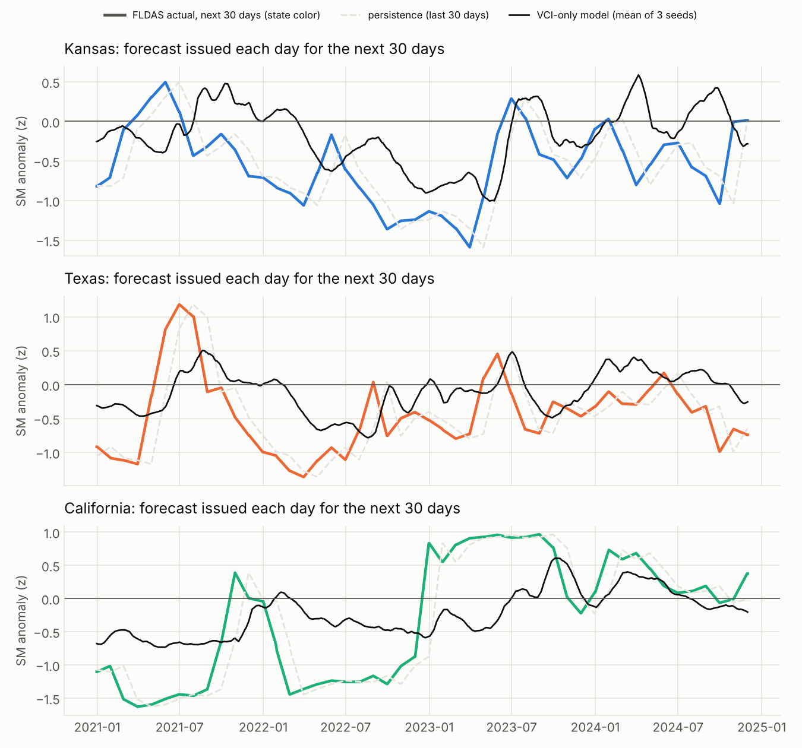
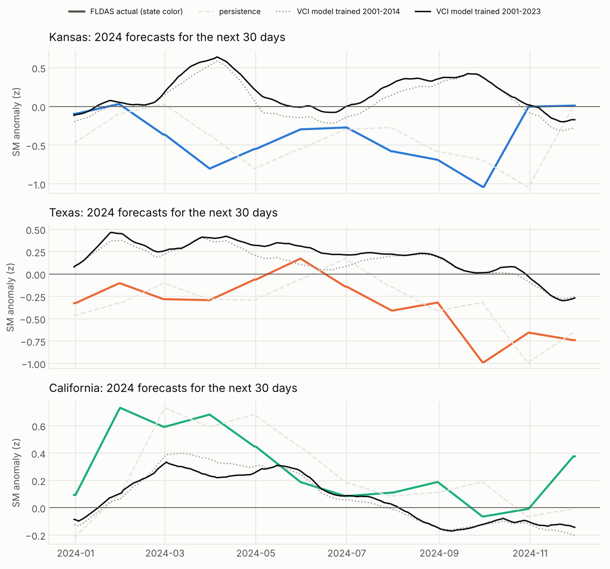
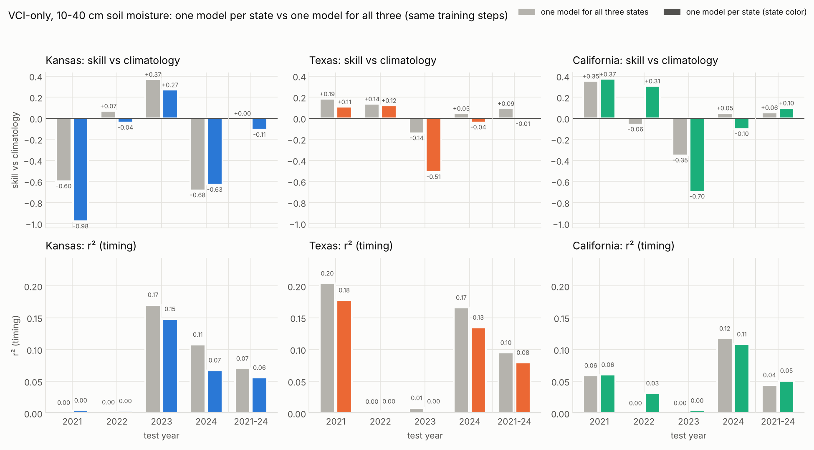
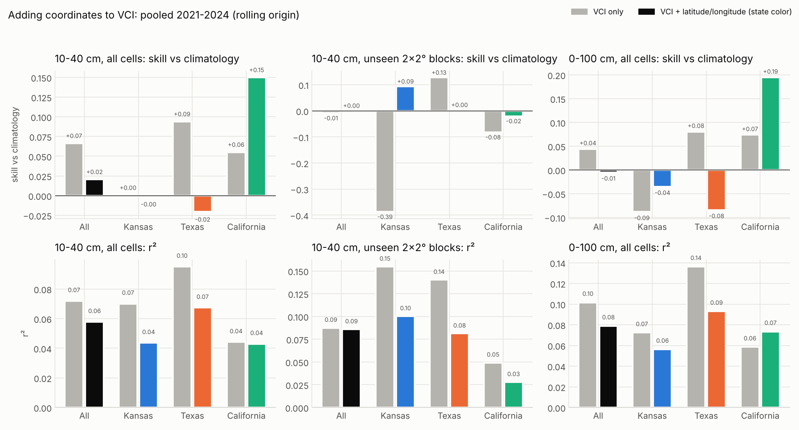
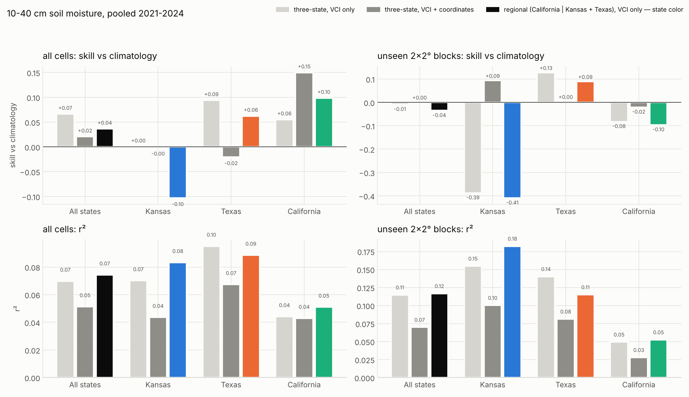
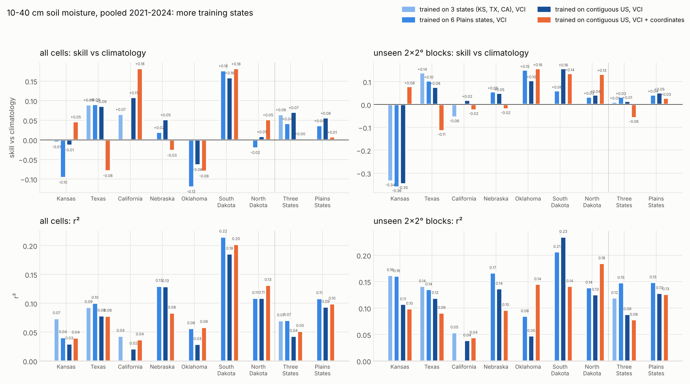
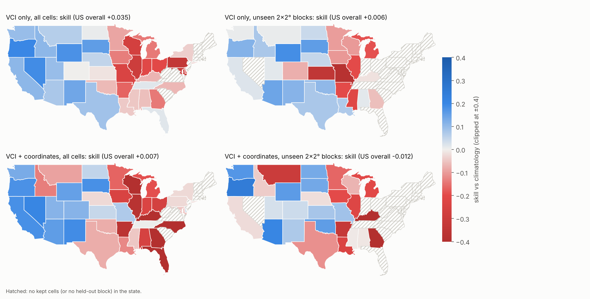

# Results — VCI → FLDAS root-zone soil moisture

Setup: [`SPLIT_vci.md`](SPLIT_vci.md). Every number comes from `python train_vci.py`;
raw tables in [`metrics_vci/`](metrics_vci/). Seeds 42–44; mean (min–max) over seeds.
Training is deterministic: a full re-run reproduced every test MSE exactly.

## Test (2021–2024), MSE of the soil-moisture anomaly

| Model | All states | Kansas | Texas | California | r (all) |
|---|---|---|---|---|---|
| Climatology (anomaly 0) | 0.934 | 0.792 | 0.890 | 1.281 | — |
| Persistence (anomaly at t) | 0.313 | 0.240 | 0.352 | 0.287 | 0.786 |
| **VCI only** | 0.783 (0.769–0.796) | 0.736 | 0.731 | 1.023 | 0.418 |
| SM history only, change target | 0.2926 (0.2867–0.2978) | 0.2304 | **0.3239** | **0.2756** | 0.783 |
| **VCI + SM history, change target** | **0.2921** (0.2867–0.2949) | **0.2242** | 0.3254 | 0.2759 | 0.783 |

Relative to persistence:

| Model | All | Kansas | Texas | California |
|---|---|---|---|---|
| VCI only | +150% | +206% | +108% | +257% |
| SM history only | −6.6% | −4.1% | **−8.0%** | −3.9% |
| VCI + SM history | **−6.8%** | **−6.7%** | −7.5% | −3.8% |

95% interval of MSE(model) − MSE(persistence), resampling whole test months:
VCI + SM history −0.0399…+0.0005, −0.0386…−0.0003, −0.0469…−0.0109 (seeds 42, 43, 44);
SM history only −0.0409…−0.0006, −0.0353…+0.0035, −0.0471…−0.0095.

## Spatial check (8 unseen 2°×2° blocks, 78 cells, test years)

| Model | All | Kansas | Texas | California |
|---|---|---|---|---|
| Persistence | 0.301 | 0.130 | 0.359 | 0.282 |
| VCI only | 0.927 (+208%) | 0.914 (+606%) | 0.772 | 1.141 |
| SM history only | **0.278 (−7.8%)** | 0.130 (+0.6%) | **0.321 (−10.6%)** | 0.270 (−4.4%) |
| VCI + SM history | 0.279 (−7.4%) | **0.123 (−5.2%)** | 0.326 (−9.1%) | **0.269 (−4.8%)** |

## Figures

- [MSE vs persistence, with and without VCI](figures_vci/skill_vs_persistence.png)
- [State-mean test series: actual, persistence and each model](figures_vci/test_series.png)

## Read

- **VCI does carry soil-moisture signal on its own**, but much less than the soil-moisture
  record itself. VCI-only cuts error 16% against climatology (0.783 vs 0.934, r 0.42), yet
  it is 2.5× persistence's error. Vegetation lags and smooths soil moisture, and the
  test-series figure shows VCI-only tracking the slow swings and missing the month-to-month
  moves. Training also peaks later (best epoch 3–6, not 1), a sign of a harder, weaker
  signal.
- **With soil-moisture history, the change-target model beats persistence by about 7%**,
  the same recipe that worked for SPEI. It wins in every state and on unseen blocks. The
  bootstrap interval excludes zero for 2 of 3 seeds and just touches it for the third.
- **VCI adds almost nothing on top of soil-moisture history overall**: 0.2921 with VCI vs
  0.2926 without, inside the seed spread (per seed −1.0% to +0.4%). The exception is
  **Kansas**: VCI lowers MSE in all three seeds (−1.9% to −3.6%) and on unseen Kansas
  blocks (−5.2% vs +0.6% without). Kansas is cropland and grassland, where vegetation
  responds quickly to root-zone moisture. In Texas, VCI slightly hurts (+0.6% and +1.4% in
  2 of 3 seeds).
- **Bottom line**: if the operational question is "estimate soil moisture where we have
  satellite vegetation data but no soil-moisture record", VCI alone gives a weak but real
  estimate (r 0.42). If the soil-moisture history is available, VCI is only worth adding
  for Kansas-like cropland.

## Daily inference, VCI only (`train_vci_daily.py`)

A forecast issued every day of 2021–2024 for the next 30 days (514,088 samples). Input is
VCI alone. Mean over seeds 42–44 (min–max); "ensemble" averages the three models as
`predict_vci_daily.py` does.

| Test MSE | All states | Kansas | Texas | California | r (all) |
|---|---|---|---|---|---|
| Climatology (anomaly 0) | 0.883 | 0.757 | 0.829 | 1.240 | — |
| Persistence (last 30 days) | 0.218 | 0.172 | 0.243 | 0.199 | — |
| **VCI only, daily** | **0.749** (0.735–0.757) | 0.671 | 0.710 | 0.992 | 0.353 |
| VCI only, daily, 3-seed ensemble | 0.745 | 0.666 | 0.706 | 0.986 | 0.355 |
| vs climatology | −15.1% | −11.4% | −14.3% | −20.0% | |

- **Issue days on month-ends only**: 0.802, −14.2% vs climatology (0.935). The monthly
  MOD13C2 VCI-only model above scored 0.783 on the same kind of target, so issuing daily from
  16-day composites costs nothing in skill and gives a fresh forecast every day.
- **Unseen 2°×2° blocks**: 0.869 vs climatology 0.927 (−6.3%). Texas −13.9% and California
  −3.9% hold up, but **Kansas is worse than climatology on unseen blocks** (+23.4%,
  r 0.08). VCI's link to soil moisture in Kansas does not transfer to Kansas cells the model
  never saw.
- **Persistence is still far better** (0.218): the VCI-only model has 3.4× its error, and the
  bootstrap interval of the gap is +0.43 … +0.63 for every seed. Persistence needs the
  soil-moisture record, which this model deliberately does not use.
- Best epoch 1 for every seed (spatial seed 42: epoch 2); about 3.8 minutes per model.
- Equivalence check on seed 42: PASS.

The figure shows what VCI can and cannot do. The model follows the slow drought swings
(Kansas 2022–23, Texas 2022) but lags or misses sharp wet-ups (California winter 2022–23),
because vegetation greens weeks after the soil wets. It also stays near the middle where
the actual anomaly is extreme.

## Retraining on 2001–2023 to fix the offset: did not work (`train_vci_daily_recent.py`)

Goal: remove the level offset by training up to the test year, as in deployment. Epoch
count picked with 2023 as validation (best epoch 1 for every seed), then each seed retrained
on all 2001–2023 windows (593,427 samples) for that many epochs. Test: every issue day whose
30-day window lies in 2024 (120,983 samples). Input and label definitions unchanged. The
2001–2014 models are scored on the same days.

| 2024, all states | MSE | R² | r² | scale penalty | offset penalty | mean predicted | mean actual |
|---|---|---|---|---|---|---|---|
| Climatology (0) | **0.541** | −0.13 | — | — | 0.13 | 0.00 | −0.25 |
| Persistence | 0.184 | 0.62 | 0.65 | 0.03 | 0.00 | −0.24 | −0.25 |
| VCI, trained 2001–2014 | 0.660 | −0.37 | 0.10 | 0.20 | 0.28 | +0.12 | −0.25 |
| VCI, trained 2001–2022 | 0.743 | −0.55 | 0.09 | 0.23 | 0.40 | +0.19 | −0.25 |
| **VCI, trained 2001–2023** | 0.701 (seeds 0.647–0.760) | −0.46 | 0.09 | 0.19 | **0.37** | +0.17 | −0.25 |

Per state (MSE, trained 2001–2023 vs 2001–2014 vs climatology): Kansas 0.868 / 0.757 / 0.402,
Texas 0.733 / 0.696 / 0.648, California 0.357 / 0.402 / 0.374. Only California improves.

**Why**: the VCI → soil-moisture relationship is not stable over time. With the 2001–2014
fit (SM anomaly = −1.08 + 0.021 × VCI), soil moisture in 2015–2020 was wetter than VCI
implied (+0.29 on average) and 2021–2024 drier (−0.34). In 2024 vegetation was greener than
average (mean VCI 57.6, among the highest years), but 0–100 cm soil moisture was below normal
(−0.25). A VCI-only model must call 2024 wet, and adding 2015–2023 to training raised its
"wet" level instead of lowering it. Year table: `metrics_vci_daily_recent/vci_vs_sm_by_year.csv`.

Likely causes, not separated here: the label is weighted 60% to the 40–100 cm layer, which
recovers slowly, while vegetation responds to the upper layers; Terra (and later Aqua)
drifted to earlier overpass times after about 2020, which can shift NDVI; and greening
trends move VCI against a fixed 2000–2014 reference. One test year is also a small sample.

Not adopted: `predict_vci_daily.py` keeps the 2001–2014 models. Equivalence check on the
2001–2023 seed-42 model: PASS.

## VCI-only tactics that keep the input fixed (`vci_tactics.py`)

The input is always the same daily VCI. Varied: the soil-moisture **label depth**,
**recency weighting** of training draws (weight halves every 3.5 years back), and
**recalibration** of the output: *scale* (linear map fitted on the training period) and
*scale+offset* (also shift each test year by the mean error of the 12 months before it;
this uses soil-moisture labels already known at issue time, not a model input).
Rolling origin: each of 2021, 2022, 2023, 2024 forecast every day by models trained on
2001 … the year before. One epoch per model (every early-stopped VCI run picked epoch 1),
seeds 42–44, 96 models. Each label is scored against its own climatology.

Skill vs climatology (1 − MSE / MSE of predicting 0), all states:

| Label | Weighting | Calibration | Pooled 2021–24 | 2021 | 2022 | 2023 | 2024 |
|---|---|---|---|---|---|---|---|
| 0–100 cm | uniform | raw (**current**) | 0.044 | 0.192 | 0.072 | 0.029 | −0.281 |
| **10–40 cm** | uniform | raw | **0.066** | 0.179 | 0.082 | 0.006 | **−0.103** |
| 10–40 cm | recency | raw | 0.046 | 0.162 | 0.055 | −0.067 | −0.043 |
| 0–10 cm | uniform | raw | 0.020 | 0.075 | 0.044 | −0.060 | 0.009 |
| 40–100 cm | uniform | raw | 0.048 | 0.228 | 0.103 | 0.072 | −0.479 |
| 0–100 cm | uniform | scale | 0.016 | 0.181 | 0.065 | −0.005 | −0.373 |
| 0–100 cm | uniform | scale+offset | 0.092 | 0.292 | 0.358 | −0.293 | −0.236 |
| 40–100 cm | recency | scale+offset | **0.095** | 0.326 | 0.299 | −0.091 | −0.362 |
| Persistence (0–100 cm, reference) | | | | 0.719 | 0.876 | 0.690 | 0.660 |

Full grid (24 combinations × 4 states × 4 years): `metrics_vci_tactics/`.

Read:

- **No tactic beats climatology in all four years.** VCI alone does not carry the year-to-year
  level of soil moisture; every variant has at least one losing year.
- **Label depth matters most for robustness.** The 10–40 cm layer gives the best pooled skill
  without calibration (0.066 vs 0.044 now) and the smallest worst-year loss among the
  label-only variants (2024: −0.10 vs −0.28). Texas 0.094 and California 0.055 pooled; Kansas
  0.000 (it was −0.088 with the 0–100 cm label). The 40–100 cm layer has the highest r² (0.13)
  but swings hardest in level, and 0–10 cm is too noisy for VCI (r² 0.03).
- **The offset correction doubles pooled skill but is a bet on persistence of the annual
  anomaly.** It helps strongly when one dry year follows another (2021, 2022: +0.10 to +0.29)
  and hurts badly when the year flips (2023: after a very dry 2022 it shifted forecasts by
  −0.58 and lost 0.3). It also relies on soil-moisture labels, which you may not have in
  practice.
- **Scale recalibration does nothing useful**: the fitted slopes are 0.77–1.23, so the model is
  calibrated on its training years; its flatness only appears out of sample.
- **Recency weighting is mixed**: it softens 2024 and hurts 2021–2022, no net gain.

Recommendation, keeping VCI as the only input: switch the label to 10–40 cm, uniform
weights, no recalibration, for the most reliable results. Use scale+offset only if recent
soil-moisture labels are available and a bad year in exchange for better average skill is
acceptable.

## One model per state vs one model for all three (`vci_per_state.py`)

Same setup as the tactics grid (VCI-only input, 10–40 cm label, uniform weights, raw output,
rolling origin 2021–2024, seeds 42–44, one epoch), but each model trains on one state's cells
only. Each gets as many training draws as the three-state model, so both take the same
number of optimizer steps; the smaller states therefore see each sample more often (Kansas
about 4×, California about 6×, Texas about 1.7×). The three states ran as parallel processes.

Skill vs climatology, pooled 2021–2024 (per year in the figure):

| State | One model for all three | One model per state | r² (all → per state) |
|---|---|---|---|
| Kansas | **0.000** | −0.109 | 0.070 → 0.056 |
| Texas | **0.094** | −0.007 | 0.095 → 0.079 |
| California | 0.055 | **0.099** | 0.044 → 0.051 |

- **Pooling helps Kansas and Texas** and loses only in California. In every state, timing (r²)
  is better or equal with the shared model in 3 of 4 years.
- **The single-state models swing harder**: their worst years are worse (Kansas 2021 −0.98 vs
  −0.60, Texas 2023 −0.51 vs −0.14, California 2023 −0.70 vs −0.35), consistent with
  overfitting a few effective cells by reusing them several times.
- **California gains** (2022: +0.31 vs −0.06): its VCI-to-soil-moisture relationship differs
  most from the Great Plains', so it benefits from a model of its own.
- Implication for scaling up: more regions help where the vegetation–soil-moisture
  relationship is similar (Kansas and Texas help each other), and can hurt where it differs
  (California). A national VCI-only model would likely help the Plains and dilute regions such
  as California, unless the regions are trained separately.

Raw: `metrics_vci_per_state/{kansas,texas,california}.csv`, comparison table
`metrics_vci_per_state/comparison.csv`.

## VCI + coordinates (`vci_coords.py`)

Input: the daily VCI blocks plus the cell's latitude and longitude (standardized, constant
over the 12 steps), so the model can learn a different VCI–soil-moisture mapping by
location. Otherwise the tactics setup: three-state model, uniform weights, raw output,
rolling origin 2021–2024, one epoch, seeds 42–44. Equivalence check PASS for every run.

Skill vs climatology, pooled 2021–2024 (worst single year in brackets):

| | All states | Kansas | Texas | California |
|---|---|---|---|---|
| 10–40 cm, VCI only | **0.066** (−0.10) | 0.000 | **0.094** | 0.055 |
| 10–40 cm, VCI + coordinates | 0.020 (−0.21) | −0.001 | −0.021 | **0.150** |
| 0–100 cm, VCI only | **0.044** (−0.28) | −0.088 | **0.080** | 0.074 |
| 0–100 cm, VCI + coordinates | −0.005 (−0.37) | −0.035 | −0.084 | **0.195** |
| 10–40 cm unseen blocks, VCI only | −0.009 | −0.387 | **0.128** | −0.082 |
| 10–40 cm unseen blocks, VCI + coordinates | 0.001 | **0.094** | 0.004 | −0.021 |

r² (timing) is equal or lower with coordinates almost everywhere (10–40 cm, all states:
0.072 → 0.058).

- **No overall gain.** Coordinates lower pooled skill (0.066 → 0.020 for 10–40 cm,
  0.044 → −0.005 for 0–100 cm) and deepen the worst year.
- **They help where the relationship is different, and hurt where it was already shared.**
  California improves strongly (10–40 cm 0.055 → 0.150; 0–100 cm 0.074 → 0.195), the same
  state that did better with a model of its own. Texas loses most of its skill (0.094 →
  −0.021).
- **On unseen blocks, coordinates fix Kansas** (−0.39 → +0.09): the location tells the model
  which regional mapping to apply to Kansas cells it never saw. Texas unseen falls
  (0.13 → 0.00), and the overall is unchanged.
- **Why Texas drops**: with coordinates the model can learn each location's average
  anomaly in the training years. That is a level that drifts from period to period (the
  offset problem), so locally memorized levels carry over into wrong test-year levels. Timing
  skill (r²) also falls, a sign of overfitting location patterns in one epoch.
- **Implication**: what coordinates buy here is mostly a regional switch. A separate model
  per region (California vs the Plains) gets the California gain without costing Texas.
  Coordinates would need stronger regularization, or a coarser region code, to help overall.

## Regional models: California alone, Kansas + Texas together (`vci_regional.py`)

VCI-only input, 10–40 cm label, rolling origin 2021–2024, one epoch, seeds 42–44, and the
same number of training draws as the three-state model. In the Plains model, Kansas and
Texas are drawn in proportion to their effective independent cells. Unseen blocks are the
same 8 as before. The California model reproduced the per-state California run exactly.
Equivalence check PASS for all four runs.

Skill vs climatology, pooled 2021–2024 (r² in brackets):

| | All states | Kansas | Texas | California |
|---|---|---|---|---|
| Three-state, VCI only | **0.066** (0.070) | **0.000** (0.070) | **0.094** (0.095) | 0.055 (0.044) |
| Three-state, VCI + coordinates | 0.020 (0.051) | −0.001 (0.044) | −0.021 (0.067) | **0.150** (0.043) |
| Regional, VCI only | 0.036 (**0.074**) | −0.103 (**0.083**) | 0.062 (0.089) | 0.099 (**0.051**) |
| Unseen blocks: three-state, VCI only | −0.009 | −0.387 | **0.128** | −0.082 |
| Unseen blocks: three-state + coordinates | **0.001** | **0.094** | 0.004 | **−0.021** |
| Unseen blocks: regional, VCI only | −0.035 | −0.409 | 0.090 | −0.096 |

- **Splitting by region does not beat one shared model** (0.036 vs 0.066 overall). California
  gains (0.055 → 0.099), but Kansas (0.000 → −0.103) and Texas (0.094 → 0.062) lose.
- **California's data was helping the Plains.** Removing it made the Kansas and Texas level
  forecasts worse, even though timing (r²) improved slightly in Kansas (0.070 → 0.083). More
  varied training years and regimes seem to steady the level, which is the hard part.
- **Unseen Kansas blocks stay bad** with the regional model (−0.41): only coordinates fixed
  them (+0.09).
- **No single variant wins everywhere**: Texas is best with the three-state VCI-only model,
  California with three-state + coordinates, Kansas unseen with coordinates. Picking a variant
  per state from these test results would be selection on the test set; with only 4 test
  years the differences between variants (about ±0.05 in pooled skill) are about the size of
  year-to-year noise.
- **Recommendation stands**: the three-state VCI-only model (10–40 cm label) is the best and
  most robust overall. More regions of the same kind (more Plains states), rather than
  splitting, is the more promising way to add data.

## More states: 6 Plains states and the contiguous US (`vci_us.py`)

One FLDAS pull and one MOD13C1/MYD13C1 crop for the whole contiguous-US box
(`download_fldas_us.py`, `download_vci16.py --box us`), split into states by the Census
borders, with the same cell rules as before (`data_us.py`, `shared_split_us.py`). FLDAS was
pulled with only the variables the VCI setup uses (three soil layers and rain).

| Rule | Removed | Kept |
|---|---|---|
| 0.5° cells with any valid FLDAS land cell | | 4,255 |
| SPEI-12 present | 2 | 4,253 |
| Center inside a contiguous-US state | 966 | 3,287 |
| FLDAS present every month | 0 | 3,287 |
| Not hyper-arid | 27 | 3,260 |
| Stable SPEI-12 | 0 | 3,260 |
| ≥ 30 % grassland/cropland (MCD12Q1 2010) | 1,246 | **2,014** |

2,014 cells in 38 states (Texas 209, Montana 159, Wyoming 112, Colorado 105, New Mexico 97,
...). The other 11 states (mostly forested New England and the Appalachians) have no cell that
passes the land-cover rule. For Kansas, Texas and California the US build has the same 359
cells with identical daily VCI, and 10–40 cm labels that match to correlation 0.999996
(the old per-state boxes cut a few border cells slightly).

Models: VCI only (and VCI + latitude/longitude for the US), 10–40 cm label, rolling origin
2021–2024, one epoch over every training sample, seeds 42–44, states drawn in proportion to
their effective independent cells. All four models use this same build, so the three-state
model is retrained here as the baseline. Unseen blocks: the 8 blocks the three-state runs held
out, plus 20 % of the blocks with no three-state cell. Equivalence check PASS for every model.
A US model takes about 5.5 minutes on one CPU thread (2,014 cells; 2.6 M training draws for
2024); all 20 jobs took 76 minutes on 4 CPUs.

Skill vs climatology, pooled 2021–2024 (r² in brackets):

| | 3 states, VCI | 6 Plains states, VCI | US, VCI | US, VCI + coordinates |
|---|---|---|---|---|
| Kansas | −0.006 (0.074) | −0.096 (0.041) | −0.014 (0.030) | **0.047** (0.040) |
| Texas | **0.090** (0.093) | **0.091** (0.100) | 0.086 (0.078) | −0.079 (0.078) |
| California | 0.066 (0.043) | – | 0.108 (0.021) | **0.182** (0.037) |
| KS + TX + CA pooled | 0.065 | – | **0.070** | 0.004 |
| 6 Plains states pooled | – | 0.037 | **0.056** | 0.008 |
| All 38 states pooled | – | – | **0.035** | 0.007 |
| West of 98°W (16 states) | – | – | **0.096** | 0.077 |
| East of 98°W (22 states) | – | – | **−0.155** | −0.214 |
| Unseen: Kansas | −0.335 | −0.360 | −0.347 | **0.078** |
| Unseen: Texas | **0.138** | 0.104 | 0.077 | −0.114 |
| Unseen: California | −0.055 | – | **0.020** | −0.023 |
| Unseen: KS + TX + CA pooled | 0.012 | 0.032 | 0.015 | −0.058 |
| Unseen: all 38 states pooled | – | – | **0.006** | −0.012 |

- **One US model is at least as good as the three-state model on the original states**
  (pooled 0.070 vs 0.065), mostly from California (0.066 → 0.108); Kansas and Texas are
  unchanged within noise. Its worst year is also less bad (Kansas −0.45 vs −0.69,
  California −0.14 vs −0.38). Timing (r²) is a little lower, so the gain is in the level.
- **The six-state Plains model did not help.** Kansas got worse (−0.006 → −0.096), Texas
  stayed the same, and over the six Plains states it is below the US model (0.037 vs 0.056).
  The US model's extra variety again helped more than more of the same climate.
- **VCI works in the West and fails in the East.** West of 98°W the US model scores 0.096;
  east of it −0.155 (Corn Belt and the Southeast: Illinois −0.29, Wisconsin −0.27,
  Pennsylvania −0.34). There, plants are rarely water-limited and irrigation and crop calendars
  drive greenness, so VCI says little about soil moisture. Eastern cells are 26 % of the test
  samples, which pulls the US-wide score down to 0.035.
- **Coordinates help the arid West but hurt elsewhere.** With coordinates, California
  (0.182), Arizona, New Mexico and unseen Kansas blocks (+0.078, the only model that fixes
  them) improve, but Texas (−0.079) and the East get worse; overall 0.035 → 0.007. Same
  pattern as in the three-state runs: location lets the model memorize local offsets, and they
  do not carry to new years everywhere.
- **Unseen blocks are still the hard case**: −0.35 in Kansas without coordinates for every
  region choice. More training states did not fix spatial generalization.
- **Recommendation**: train one shared VCI-only model, but on the water-limited West (the
  16 states west of 98°W, or the cells where VCI and soil moisture are correlated in the train
  years) rather than the whole US. The US model already scores 0.096 there; a West-only model
  is the next run to try. Eastern cells should not get VCI-only forecasts.

`check_equivalence.run` on seed 42 of every variant: PASS (float32 and float64).
MOD13C2 download 4.0 min; `data_vci.py` 3.1 min; training all 18 models (3 variants ×
3 seeds × main + spatial) about 10 minutes on CPU.

## Next steps

- Nowcast instead of forecast (VCI at t → soil moisture at t). VCI responds to past moisture,
  so the t+1 horizon may undersell it.
- Add Aqua MYD13C2 and EVI or VCI at shorter lags (16-day MOD13A2) for a sharper signal.
- Try the 10–40 cm layer as the label, which vegetation roots sample most directly.
